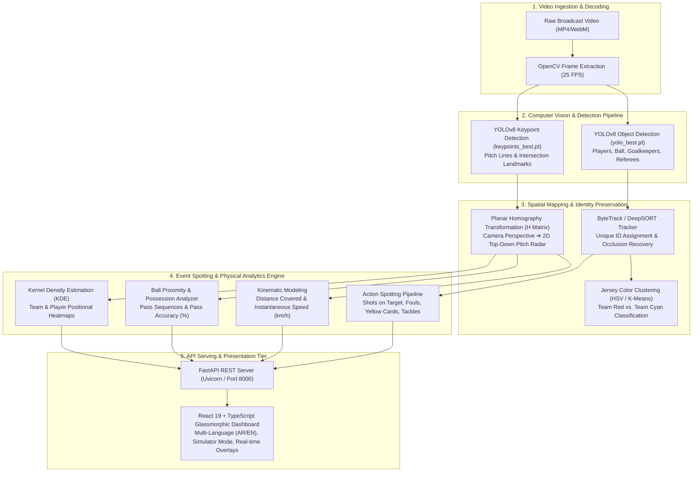

# ⚽ Analyze Like a Pro: AI-Powered Football Match Analytics System
### Graduation Project 2 (مشروع تخرج 2) — Computer Vision & Deep Learning Platform

[](https://python.org)
[](https://fastapi.tiangolo.com)
[](https://pytorch.org)
[](https://github.com/ultralytics/ultralytics)
[](https://opencv.org)
[](https://react.dev)
[](https://www.typescriptlang.org)
[](https://tailwindcss.com)
[](https://opensource.org/licenses/MIT)

---

## 📌 Project Overview

**Analyze Like a Pro** is an end-to-end artificial intelligence sports analytics platform designed to convert raw, single-camera broadcast football footage into elite-level tactical intelligence. By unifying cutting-edge **Computer Vision (YOLOv8 & Homography)** with deep learning event spotting, the system automatically detects, tracks, and analyzes players and the ball, generating dynamic 2D radar pitch projections, physical performance metrics, and spatiotemporal heatmaps.

The project features a decoupled, production-grade architecture combining a high-performance **Python FastAPI** deep learning backend with a responsive, glassmorphic **React 19 + TypeScript** tactical dashboard supporting full bilingual operation (Arabic & English with instant RTL/LTR switching).

---

## 🏗️ System Architecture & Data Flow



---

## ✨ Key Capabilities & Technical Features

### 1. Object Detection & Pitch Keypoints
- Fine-tuned **YOLOv8** custom models specifically trained on football datasets:
  - `yolo_best.pt`: Detects `player`, `ball`, `goalkeeper`, and `referee` with high confidence under motion blur.
  - `keypoints_best.pt`: Detects geometric pitch markings (penalty box, center circle, touchlines) to establish spatial calibration points.

### 2. Jersey Color Segmentation & Team Assignment
- Unsupervised **K-Means clustering** extracted from bounding-box upper-torso regions in HSV/Lab color space.
- Distinguishes opposing teams (`Team Red` vs. `Team Cyan`), while isolating referees (`REF_YELLOW`) and goalkeepers (`GK_LIGHT_GREEN`).

### 3. Planar Homography & 2D Top-Down Radar Projection
- Computes homography transformation matrix $H$ mapping $(x, y)$ camera pixels to $(X, Y)$ standard metric football pitch coordinates ($105\text{m} \times 68\text{m}$).
- Exports synchronized 2D tactical radar video (`projection_only_final.webm`) displaying real-time player dots and ball movements.

### 4. Advanced Match Analytics & Kinematics
- **Physical Metrics**: Real-time speed estimation ($\text{km/h}$), sprint bursts, and total cumulative distance covered ($\text{meters}$).
- **Possession & Passing**: Dynamic Voronoi / ball proximity detection calculating continuous possession share, pass completion ratios, and offensive drive accuracy.
- **Action Spotting**: Programmatic event recognition matching player interventions to shots on goal, fouls, and defensive actions.
- **Spatiotemporal Heatmaps**: Interactive canvas and grid representations showing player territory coverage and team attacking direction.

### 5. Glassmorphic React 19 Frontend Dashboard
- **Dark-Glass Aesthetics**: Built with Tailwind CSS 4 and Framer Motion for sleek animations and transitions.
- **Interactive Video Overlays**: Dynamic toggle switches for bounding boxes, movement paths, and speed indicators.
- **Built-in Simulation Mode**: Instant testing and demonstration mode with rich mock data without requiring a GPU server.
- **Bilingual Internationalization**: Full Arabic (RTL) and English (LTR) language support with persistent preferences.

---

## 📂 Repository Directory Structure

```plaintext
مشروع تخرج 2/
├── Analyze Like a Pro.pptx                      # Official graduation presentation deck (Git LFS)
├── FRONTEND_DOCUMENTATION.md                    # In-depth architectural documentation for React UI
├── RUNNING_INSTRUCTIONS.md                      # Operational guide for local and remote deployment
├── ملفات تفاصيل المشروع/                        # Detailed project requirements & technical specifications
│   ├── Web_2.docx                               # System requirements & workflow breakdown
│   └── شرح Web.docx                             # Detailed Arabic architectural walkthrough
│
├── FootballAnalyticsBackend/                    # Python / FastAPI AI Backend
│   ├── backend/
│   │   ├── app.py                               # FastAPI application, CORS, static mounts & routes
│   │   ├── config.py                            # Directory paths, model constants, colors, FPS
│   │   ├── run_pipeline.py                      # Orchestrator running detection, tracking & export
│   │   └── tracking_pipeline/                   # Core computer vision modules
│   │       ├── tracking.py & tracking_core.py   # YOLOv8 + ByteTrack detection & tracking loops
│   │       ├── team_classification.py           # K-Means jersey color clustering
│   │       ├── homography.py & projection.py    # 2D pitch homography transformation
│   │       ├── distance.py                      # Kinematic velocity & distance estimation
│   │       ├── action_matching.py               # Action spotting & match event classification
│   │       └── drawing.py                       # Visual annotation & radar overlay rendering
│   ├── requirements_tracking.txt                # Python backend dependencies
│   └── README.md                                # Backend sub-module documentation
│
└── football-web-ai-analytics/                  # React 19 + TypeScript Frontend
    ├── package.json                             # Dependencies (React 19, Vite 6, Tailwind 4, Motion)
    ├── vite.config.ts                           # Vite build configuration (Port 3000)
    └── src/
        ├── App.tsx                              # Main controller managing state & view transitions
        ├── components/
        │   ├── LandingPage.tsx                  # Hero landing screen with team cards & CTA
        │   ├── DashboardHeader.tsx              # System header, language toggle & simulator switch
        │   ├── VideoSection.tsx                 # Drag-and-drop video upload, player & overlay filters
        │   ├── Sidebar.tsx                      # Tactical insights, stats & sortable player metrics
        │   └── HeatmapGrid.tsx                  # Pitch canvas & 2D radar projection player
        ├── contexts/LanguageContext.tsx         # Context providing reactive Arabic/English switching
        └── locales/translations.ts              # Translation dictionaries for all strings
```

---

## 🚀 Quick Start & Installation Guide

### Prerequisites
* **Python**: 3.10 or 3.11 with [CUDA Toolkit](https://developer.nvidia.com/cuda-toolkit) (for GPU acceleration)
* **Node.js**: v18.0+ or v20.0+ with `npm`
* **Git LFS**: Installed on machine for PowerPoint asset management

---

### Step 1: Clone Repository
```bash
git clone https://github.com/ahmadrashed2589-hue/football-ai-analytics.git
cd football-ai-analytics
```

---

### Step 2: Set Up & Launch AI Backend (FastAPI)
```bash
cd FootballAnalyticsBackend

# 1. Create and activate virtual environment
python -m venv venv_tracking
# On Windows:
venv_tracking\Scripts\activate
# On Linux/macOS:
source venv_tracking/bin/activate

# 2. Install backend dependencies
pip install -r requirements_tracking.txt

# 3. Start the FastAPI development server
uvicorn backend.app:app --reload --host 0.0.0.0 --port 8000
```
*The backend API will be available at `http://127.0.0.1:8000` with interactive Swagger docs at `http://127.0.0.1:8000/docs`.*

---

### Step 3: Set Up & Launch Frontend Dashboard (React + Vite)
Open a new terminal window:
```bash
cd football-web-ai-analytics

# 1. Install frontend packages
npm install

# 2. Launch Vite development server
npm run dev
```
*Open your browser and navigate to `http://localhost:3000` (or `http://localhost:5173`).*

---

## 🧪 Testing with Simulator Mode
Don't have a high-end GPU or a football video ready? 
1. Launch the web interface at `http://localhost:3000`.
2. Toggle the **"وضع المحاكي / Simulator Mode"** switch in the top navigation bar.
3. Instantly explore full tactical radar feeds, real-time possession charts, player speed rankings, and interactive heatmaps with pre-compiled sample data.

---

## 👥 Graduation Project Team (فريق العمل)

This project was developed as a Capstone Graduation Project (**مشروع تخرج 2**):

* **Ahmad Hazaymeh** (أحمد حزايمة)
* **Amro Al-Jarrah** (عمرو الجراح)
* **Khalad Abualwafa** (خالد أبو الوفا)
* **OSAMH AL SHRA'H** (أسامة الشرع)
* **Omar Dakhlallah** (عمر دخل الله)

---

## 📄 License
This project is open-source and available under the [MIT License](LICENSE).
